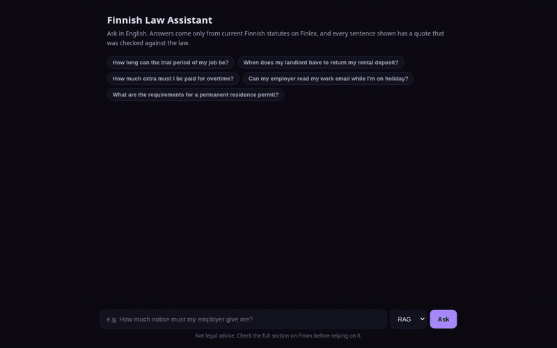

<!-- HERO -->
<p align="center">
  
</p>

<h1 align="center">
  
  &nbsp;finnish-law-assistant
</h1>

<p align="center">
  <strong>Ask about Finnish law in English. Every sentence in the answer is backed by a checked quote from the current statute.</strong>
</p>

<p align="center">
  <a href="#results"></a>
  <a href="#results"></a>
  <a href="#how-it-works"></a>
  <a href="#results"></a>
  <a href="LICENSE"></a>
</p>

<p align="center">
  <sub>Retrieval over 1,239 sections of 10 Finnish statutes, cross-language search, quotes verified in code, claims checked by a second model, and an evaluation that publishes its failures.</sub>
</p>

<p align="center"></p>

## What is this?

Finland's laws are published in Finnish and Swedish, and many people who work and rent here read
neither well. This assistant takes an English question, finds the relevant sections
of current Finnish law, and answers in English, showing the exact Finnish words behind each sentence.
If the law it has does not answer the question, it says so.

- **Current law only.** Texts come from the Finlex open data API, with a freshness check that caught the API serving versions up to 11 years old
- **Cross-language search.** English questions against Finnish statutes: keyword search, multilingual embeddings and both combined, measured
- **Cite or refuse, enforced in code.** Quotes are verified against the section text; a second model checks each quote supports its sentence; everything else is removed
- **Two pipelines compared.** One-shot retrieval (RAG) against a tool-using agent, on accuracy, cost and latency

<p align="center">
  <a href="assets/demo.mp4"></a>
  <br>
  <sub>20-second demo (<a href="assets/demo.mp4">MP4</a>), recorded live: a trial-period question and a rental-deposit question answered with checked Finnish quotes and their sections, then a question about German law refused. Waiting time is shortened; the real time and cost of each answer are shown under it.</sub>
</p>

> [!WARNING]
> Not legal advice. The assistant covers 10 statutes, not Finnish law as a whole, and it can be wrong.
> Always check the section on Finlex.

<p align="center"></p>

## Results

Questions: **73** generated from sections by a stronger model (held-out test half), **25** written by
hand with the gold section checked by reading the law, and **15** out-of-scope questions (other
countries, other laws, a prompt-injection attempt). Answers were graded by a separate judge model
against the gold section; I checked 7 random grades by hand and agreed with all 7.

| Pipeline (checker model) | Correct | Partial | Incorrect | No answer | Refused out-of-scope | Cost / question | Median time |
|---|---|---|---|---|---|---|---|
| **RAG (Haiku checker), default** | **83.7%** | 8.2% | 6.1% | 2.0% | **15/15** | **$0.011** | n/a ¹ |
| RAG (Sonnet checker) | 78.6% | 11.2% | 5.1% | 5.1% | 15/15 | $0.042 | 6.7 s |
| Agent (Sonnet checker) | 82.7% | 14.3% | **2.0%** | 1.0% | 15/15 | $0.048 | 13.1 s |

<sub>98 in-scope questions per row. ¹ The Haiku-checker run reused cached answers, so its timings are not comparable; its cost includes about $0.001 per question for writing the answer.</sub>

> [!IMPORTANT]
> **The stricter checker was not the safer one.** Claude Sonnet as the checker removed 22% of claims,
> many of them correct, turning good answers into partial ones; Haiku removed 7%. Wrong answers barely
> changed (5 against 6 of 98, within noise) while cost fell to a quarter, so Haiku is the default.
> The agent made the fewest errors and did best on the hand-written questions (80% against 64% for
> RAG with the same checker), at twice the latency.

### Retrieval: is the gold section found?

<sub>Test half, 73 questions.</sub>

| Search mode | Recall@1 | Recall@5 | Recall@10 | MRR |
|---|---|---|---|---|
| Keywords, English question | 0.01 | 0.03 | 0.03 | 0.02 |
| Keywords, translated to Finnish | 0.44 | 0.63 | 0.81 | 0.55 |
| + character 5-grams | 0.53 | 0.84 | 0.90 | 0.66 |
| Embeddings | 0.44 | 0.84 | 0.90 | 0.61 |
| Hybrid (stems + embeddings) | 0.58 | 0.93 | **0.97** | 0.72 |
| **Hybrid (5-grams + embeddings)** | **0.66** | **0.93** | 0.96 | **0.78** |

On the 25 hand-written questions the same ranking holds (MRR 0.64 best), but embeddings alone fall to MRR 0.44: generated questions borrow the section's wording, which flatters semantic search.

### What went wrong, and what I learned

- **The API served stale law.** Its version listing stopped years early for 8 of 10 statutes; the Aliens Act stopped at 2015, 69 amendments behind. The downloader now picks the version named after the newest amendment in force.
- **Finnish inflection beats stemmers.** "irtisanomisaika" and "irtisanomisajat" (notice period) stem differently; character 5-grams fixed it (recall@1 0.44 to 0.53, chosen on the dev half).
- **A silent fallback hid a bug.** Thinking used the whole token budget, translations came back empty, and the code quietly used the English text. Empty replies now raise.
- **A real quote can carry a false sentence.** The agent once cited the correct notice-period table while misreading it. Quote checks prove where words come from, not what they mean, hence the second check.
- **Summaries can sneak in rules.** One summary added an inspection duty the law doesn't state, and the summary check missed it.
- **Legal terms are hard.** "arkilauantai" (an ordinary Saturday) came out as "non-working Saturday".


<p align="center"></p>

## How it works

```text
 English question
       │
       ├────────────────────────────┐
       ▼                            ▼
 ┌───────────────────┐      ┌───────────────────┐
 │ rewrite as Finnish│      │ multilingual      │   text-embedding-3-small
 │ legal search terms│      │ embeddings        │   over 1,239 sections
 └─────────┬─────────┘      └─────────┬─────────┘
           ▼                          │
 ┌───────────────────┐                │
 │ BM25 over         │                │
 │ character 5-grams │                │
 └─────────┬─────────┘                │
           └────────────┬─────────────┘
                        ▼
              reciprocal rank fusion ──▶ top 8 sections
                        │                 (or the agent searches and reads with tools)
                        ▼
 ┌──────────────────────────────────────────────┐
 │ answer model: claims as JSON, each with      │   schema-constrained output
 │ section id + exact Finnish quote             │
 └──────────────────────┬───────────────────────┘
                        ▼
 ┌──────────────────────────────────────────────┐
 │ 1. code: quote must be in that section,      │   provenance
 │    and the section must have been provided   │
 │ 2. checker model: quote must support the     │   meaning
 │    English sentence; summary must follow     │
 └──────────────────────┬───────────────────────┘
                        ▼
      only claims that pass both are shown ── none pass? ──▶ "I won't guess"
```

<p align="center"></p>

## Install

```bash
git clone https://github.com/mahbub2649/finnish-law-assistant.git
cd finnish-law-assistant
make setup                 # Python environment
cp .env.example .env       # add your OpenRouter key
make corpus                # download current law texts from Finlex (no key needed)
make index                 # search indexes, about $0.01
```

Verify (offline, fake model, no key needed):

```bash
make test
# 10 passed
```

> [!NOTE]
> The law texts are downloaded, not committed. Finnish statutes are not protected by copyright
> (Copyright Act 404/1961, section 9), but Finlex publishes no licence for its consolidated versions,
> so the repository holds code only.

<p align="center"></p>

## Usage

<details>
<summary><b>Chat page and API</b></summary>

```bash
make serve                  # http://localhost:8200
curl -s localhost:8200/api/ask -H 'Content-Type: application/json' \
  -d '{"question": "What is the minimum wage in Germany?"}'
# {"status": "not_covered", "message": "The laws in this assistant don't cover that question.", ...}
```

`POST /api/ask` takes `question` and `pipeline` (`rag` or `agent`) and returns the status, the
summary, the verified claims with section labels, quotes and Finlex links, the claims that were
removed and why, and the model, time and cost.

</details>

<details>
<summary><b>From Python</b></summary>

```python
from lawqa.answer import ask, render

a = ask("How long can the trial period of my job be?", pipeline="agent")
print(render(a))            # summary + verified claims with citations
print(a.status, a.cost_usd) # answered | not_covered | unsupported | error
```

</details>

<details>
<summary><b>Run the evaluation</b></summary>

```bash
make eval-retrieval         # all search modes on dev, test and hand-written questions
make eval-answers           # both pipelines, judged; about $3 (model calls are cached on disk)
LAWQA_CHECK_MODEL=anthropic/claude-sonnet-5.5 make eval-answers   # the stricter checker
```

Results land in `reports/`. Search choices were made on the dev half only.

</details>

<p align="center"></p>

## Design decisions

1. **Refuse rather than guess.** For legal questions a confident wrong answer is the expensive failure, so unsupported claims are removed, not softened.
2. **Enforce it in code, not in the prompt.** Prompts ask for quotes; code checks them. The model cannot talk its way past a substring check.
3. **Check meaning, not just provenance.** A second model judges whether each quote supports its sentence, because a real quote can be attached to a wrong claim.
4. **Measure before tuning.** The evaluation set existed before any search change; the 5-gram fix was chosen on the dev half and reported on the test half.
5. **Check freshness automatically.** The fetcher records, per law, which amendment the text includes and the newest one in force.
6. **Prefer the cheaper model when the data says so.** Haiku checks as well as Sonnet here at a quarter of the cost; the stricter checker was not the safer one.
7. **Cache every model call.** Re-running the evaluation is free and reproducible, and the cache makes regressions easy to spot.
8. **Publish the failures.** The README lists the bugs found during the build and the answers that went wrong.

<p align="center"></p>

## Project layout

```text
finnish-law-assistant/
├── lawqa/
│   ├── fetch.py       Finlex download, newest-amendment-in-force version, freshness record
│   ├── parse.py       Akoma Ntoso XML to sections; versions in force; repealed sections dropped
│   ├── index.py       BM25 over Finnish stems and character 5-grams; embeddings
│   ├── retrieve.py    query translation, search modes, reciprocal rank fusion
│   ├── answer.py      RAG and agent pipelines, quote verification, support check
│   ├── llm.py         OpenRouter client with disk cache and cost accounting
│   └── api.py         FastAPI service and chat page
├── eval/
│   ├── make_questions.py   generated questions (stronger model than the one tested)
│   ├── handwritten.jsonl   25 hand-labelled + 15 out-of-scope questions
│   ├── retrieval.py        recall@k and MRR per search mode
│   └── answers.py          end-to-end answers, judged
├── reports/           all results, including every judged answer
├── tests/             10 offline tests with a fake model
└── web/index.html     chat page
```

<p align="center"></p>

## Laws covered

Employment Contracts Act (55/2001), Working Hours Act (872/2019), Annual Holidays Act (162/2005),
Non-Discrimination Act (1325/2014), Act on Equality between Women and Men (609/1986), Act on the
Protection of Privacy in Working Life (759/2004), Occupational Safety and Health Act (738/2002),
Act on Residential Leases (481/1995), Consumer Protection Act (38/1978) and Aliens Act (301/2004),
each as consolidated up to its newest amendment in force when fetched (November 2026). Source:
[Finlex](https://www.finlex.fi), Ministry of Justice, Finland.

## License

<p align="center"></p>
<p align="center"><sub>Code: MIT License © 2026 Md Mahbub Islam. Law texts: Finlex, downloaded at setup, not redistributed.</sub></p>
